<a href="https://rohanthakur.in"></a>

<p align="center">
  <a href="https://rohanthakur.in"></a>
  <a href="https://www.linkedin.com/in/rohanthakur05/"></a>
  <a href="mailto:contact@rohanthakur.in"></a>
  
</p>

## Hey, I'm Rohan.

I'm an **AI engineer who works on the business side too**. I build the apps, agents and automations companies actually run on, with no hand-offs, and I tie every build to a number: hours saved, revenue tracked, decisions made faster. *If it doesn't move a metric, it doesn't ship.*

Day to day I'm in the **Founder's Office at Next2Door Living** (EzStays + Basecamp Hostels, ~6,700 beds across 30+ properties), working across finance, growth, investor communication, product and operations.

```ts
const rohan = {
  role:       "AI Engineer · Founder's Office @ Next2Door Living",
  certified:  ["Claude Certified Associate", "Oracle Certified Generative AI Professional"],
  published:  "IEEE STCR 2025: UAV-based deep learning for wheat disease management",
  education:  "B.Tech ECE, Delhi Technological University (2021–25)",
  shipping:   ["P&L engines", "staff & field apps", "AI automations", "lead pipelines"],
  askMeAbout: ["Claude Code", "MCP & agents", "MIS / P&L", "turning spreadsheets into systems"],
};
```

## Selected work

<a href="https://rohanthakur.in/#work"></a> <a href="https://rohanthakur.in/#work"></a>
<a href="https://rohanthakur.in/#work"></a> <a href="https://rohanthakur.in/#work"></a>
<a href="https://rohanthakur.in/#work"></a> <a href="https://rohanthakur.in/#work"></a>

<sub>Most of this runs inside real businesses, so the code lives in private repos. Case studies are on <a href="https://rohanthakur.in/#work">rohanthakur.in</a>.</sub>

## Stack


<p align="center"></p>

## Shipping streak

<picture>
  <source media="(prefers-color-scheme: dark)" srcset="https://raw.githubusercontent.com/rohancooks/rohancooks/output/snake-dark.svg">
  
</picture>

<p align="center"><b>Got a process that's slowing you down?</b> <a href="mailto:contact@rohanthakur.in">Let's build what's missing →</a></p>
