  

  
  
  
  

## Hey, I'm Rohan 

I'm an **AI engineer who works on the business side too**. I build the apps, agents and automations companies actually run on, and I tie every build to a number: hours saved, revenue tracked, decisions made faster.

 &nbsp;**Founder's Office @ Next2Door Living** (EzStays + Basecamp Hostels, ~6,700 beds across 30+ properties) 
 &nbsp;**Claude Certified Associate** · **Oracle Certified GenAI Professional** 
 &nbsp;**IEEE published**: UAV deep learning for wheat disease (STCR 2025) 
 &nbsp;B.Tech ECE, **Delhi Technological University** (2021–25) 
 &nbsp;Ask me about **Claude Code, MCP & agents, MIS / P&L**, or turning spreadsheets into systems

 

## What I've shipped

Most of this runs inside real businesses, so the code lives in private repos. Case studies are on <a href="https://rohanthakur.in/#work">rohanthakur.in</a>.

## Stack

  
  
  
  
  
  
  

## Shipping streak

<picture>
  <source media="(prefers-color-scheme: dark)" srcset="https://raw.githubusercontent.com/rohancooks/rohancooks/output/snake-dark.svg">
  
</picture>

  

<h3 align="center">Got a process that's slowing you down? Let's build what's missing.</h3>

  
  &nbsp;&nbsp;
  
  &nbsp;&nbsp;
  

